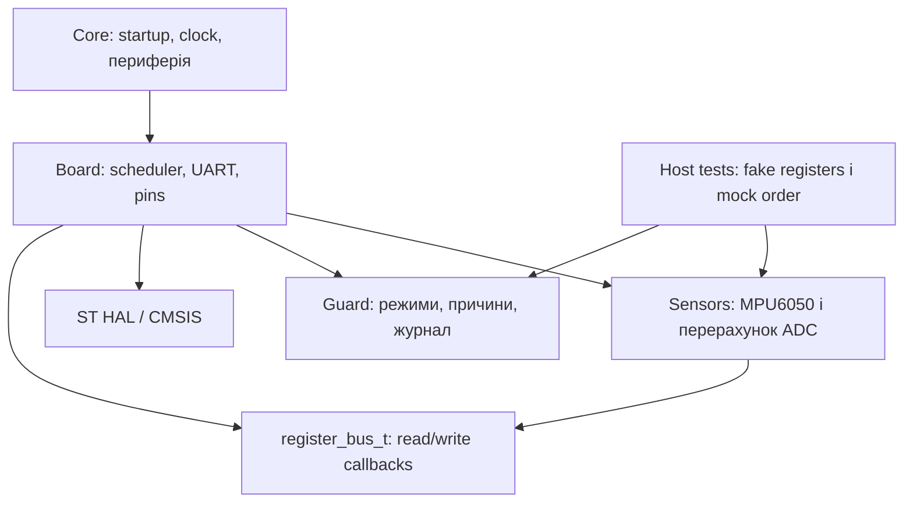

# Архітектура Lockbox

Core ініціалізує периферію й викликає Board. Board є єдиним місцем знання пінів, HAL handles, шин і планування. Sensors використовує register_bus_t з 7-bit address та callbacks, не HAL. Guard обробляє виміри, режими, фільтри, кнопку та журнал без знання плати. Vendor Drivers містить HAL/CMSIS з ліцензіями.

Переносимі каталоги не включають Core, Board, HAL або CMSIS. Автоматична перевірка include-графа та host compilation перевіряють це правило. Власні виклики Core залишаються в USER CODE; Board/Sensors/Guard не генеруються CubeMX. Регенерація потребує звірки .ioc, USER CODE і Makefile. Вендорський код не редагуємо.

Очікувана черга виконання: UART pump, кнопка/PIR, прострочений 20-мс вимір, Guard, heartbeat, телеметрія. Усі таймери порівнюють unsigned різницю tick. I²C/ADC мають обмежений timeout; UART передає буфер поступово. Частоти та фактичний jitter перевіряємо на VCD.
